# Dot Files

A complete Arch Linux desktop: qtile with a status bar that reads live system metrics, a
themed login screen and boot splash, and a colour palette that every application derives
from and that follows sunrise and sunset.

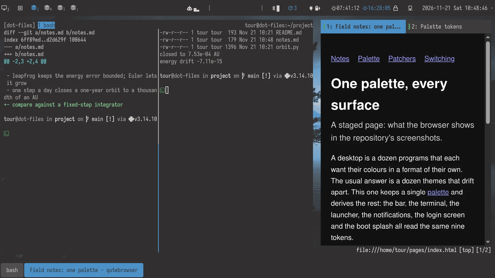

The same desktop [in light](docs/preview/desktop-light.webp); everything from the boot splash
to the lock screen is in [the tour](#a-tour) below.

## What Sets It Apart

- **One palette, every surface.** A theme is one file of named colours. The bar, the
  terminal, the launcher, the notifications, the browser, the editor, the lock screen, the
  login screen and the boot splash are each written from it, by one small patcher per
  application — [docs/architecture.md](docs/architecture.md).
- **Light and dark follow the sun.** The desktop switches at sunrise and sunset for wherever
  the machine is, and tells the running programs; the system timezone follows the same
  location — [docs/notes.md](docs/notes.md).
- **Colours are matched, not hand-picked.** Visual Studio Code and qutebrowser ship far more
  colours than anyone names by hand. Each is replaced by the nearest palette colour in a
  perceptual colour space, and how near that landed is
  [published](docs/color-distance.md), not assumed.
- **Each monitor is scaled on its own.** Bars, fonts and margins derive from each display's
  pixel density, and are recomputed when one is plugged in.
- **Themed before login.** The [boot splash](configuration/plymouth/README.md), the disk
  passphrase prompt and the [login screen](configuration/web-greeter/README.md) are drawn
  from the same palette as the desktop they lead to.
- **A lock that fails closed.** The screen lock refuses to exit rather than leave a desktop
  uncovered, shows neither the account nor the host, and locks on idle, on suspend and on
  demand — [configuration/lock/README.md](configuration/lock/README.md).
- **A bar that only reads.** A separate service collects the metrics and publishes them; the
  bar draws what is there and comes up empty, not broken, when the service is down —
  [docs/architecture.md](docs/architecture.md#backend-service-contract).
- **One command, one file.** `./bootstrap.sh` installs it, and [setup.toml](setup.toml)
  holds everything you would change first.
- **No glyph is hard-coded.** Every symbol the desktop draws is a named entry with an ASCII
  default that a theme overrides, so the theme decides which font it needs and the code
  never does — [docs/symbols.md](docs/symbols.md).
- **Checked on every commit.** Lint, tests that each guard a defect that happened, and
  documentation generated from the code it describes — [CONTRIBUTING.md](CONTRIBUTING.md).

## A Tour

From the power button to the lock screen. Every image is captured from the real programs
running the shipped theme, in a session of their own with staged content, so they show the
configuration and nothing that was on anyone's screen;
[docs/tips.md](docs/tips.md#retake-the-screenshots) has how they are retaken.

<!-- BEGIN: TOUR -->
*Generated by `helper/gendocs.py` — edits between the markers are overwritten. Change the source it reads from instead.*

| | |
|---|---|
| 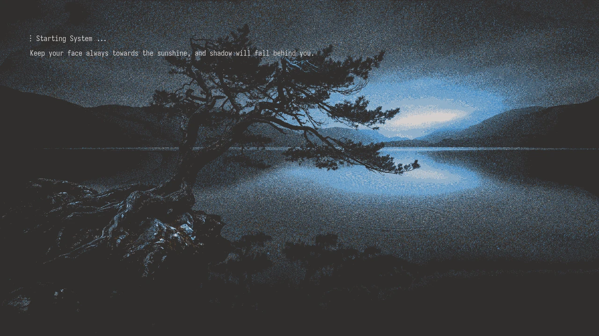<br>**Boot.** Plymouth draws the splash from the dark palette. | <br>**Decrypt.** The LUKS passphrase prompt is the same splash, not a text console. |
| 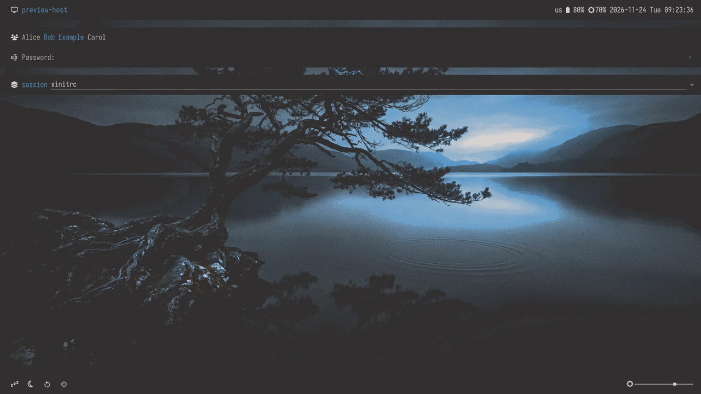<br>**Log in.** The LightDM greeter, here with the accounts its preview mode invents. | 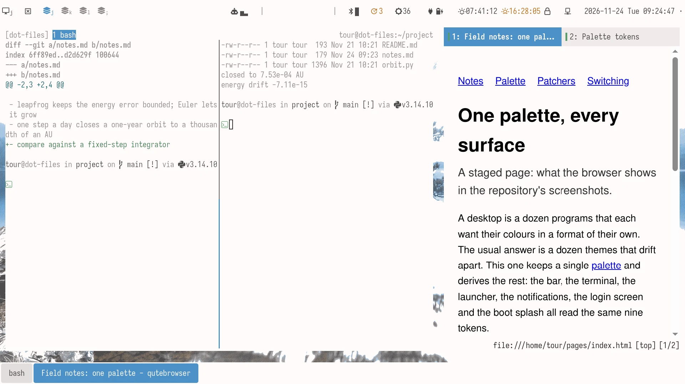<br>**The desktop, light.** The same windows after the switch that sunrise triggers. |

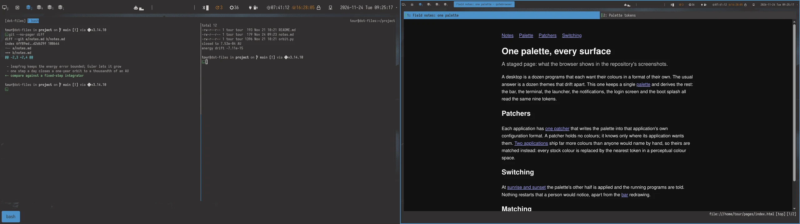<br>**Two monitors.** Each gets a bar scaled to its own pixel density; the outline marks the focused one.

| | |
|---|---|
| 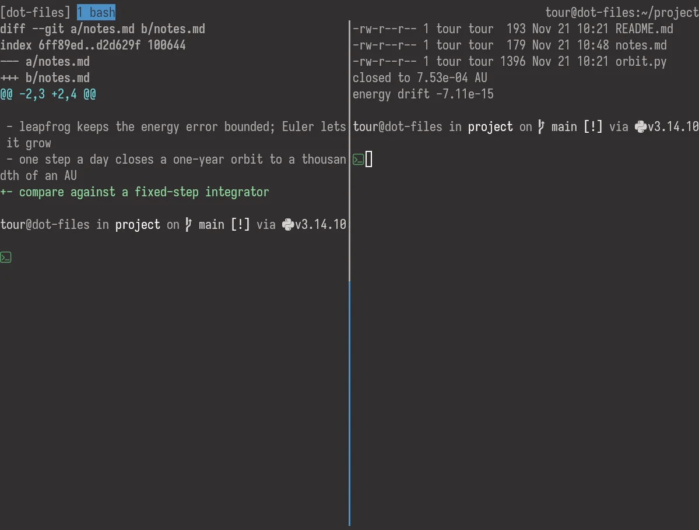<br>**Terminal.** kitty, tmux and the starship prompt. | 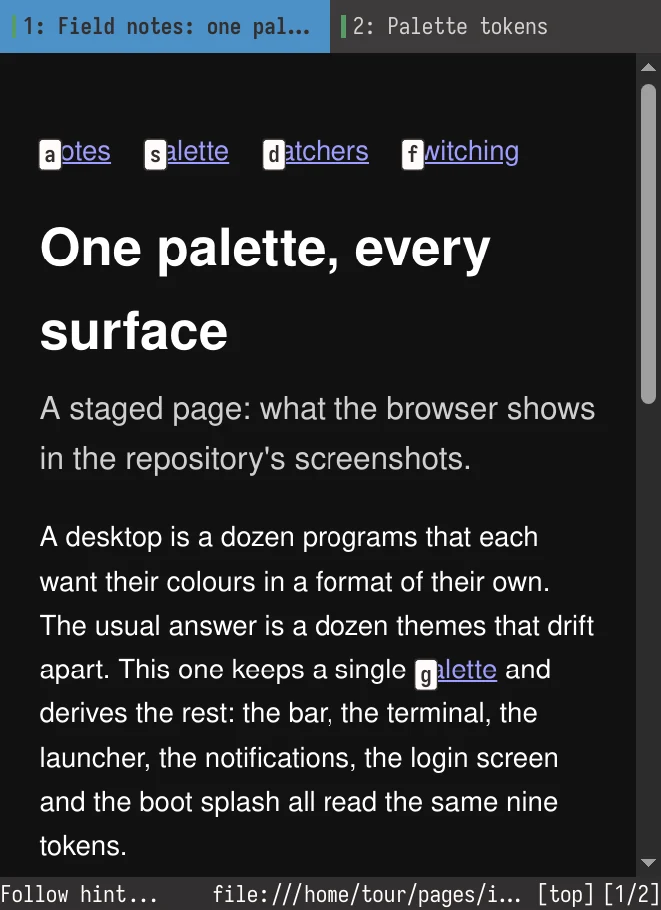<br>**Browser.** qutebrowser, every colour matched to the palette, link hints shown. |
| 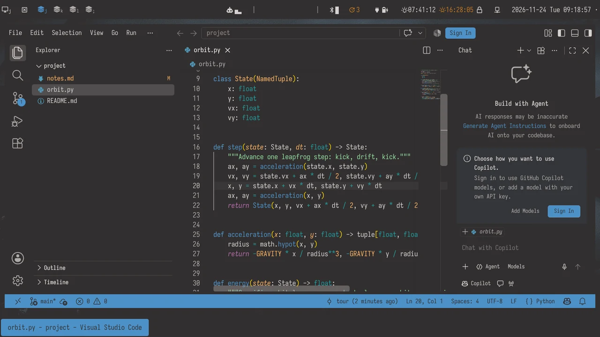<br>**Editor.** Visual Studio Code, matched the same way. | 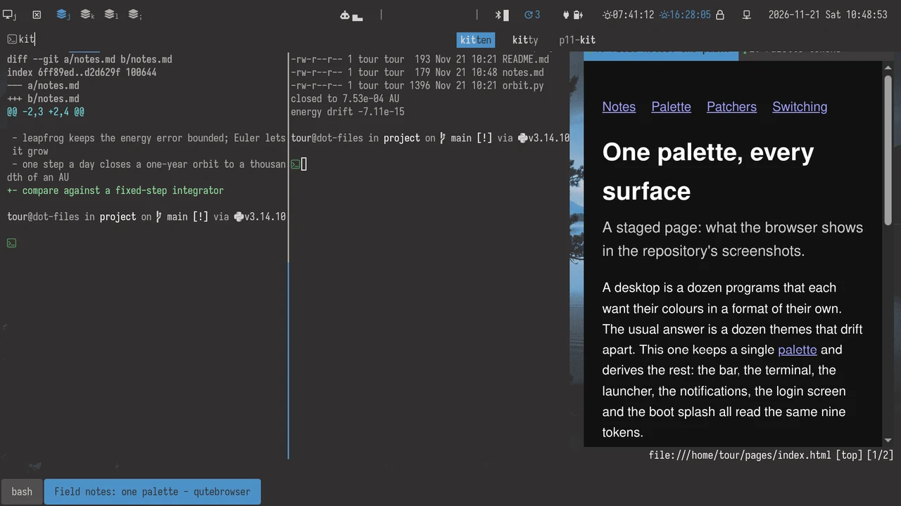<br>**Launcher.** rofi opens under the bar on the focused screen. |
| 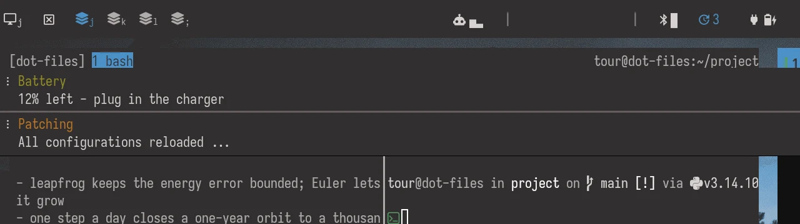<br>**Notifications.** dunst, a normal and a critical one. | 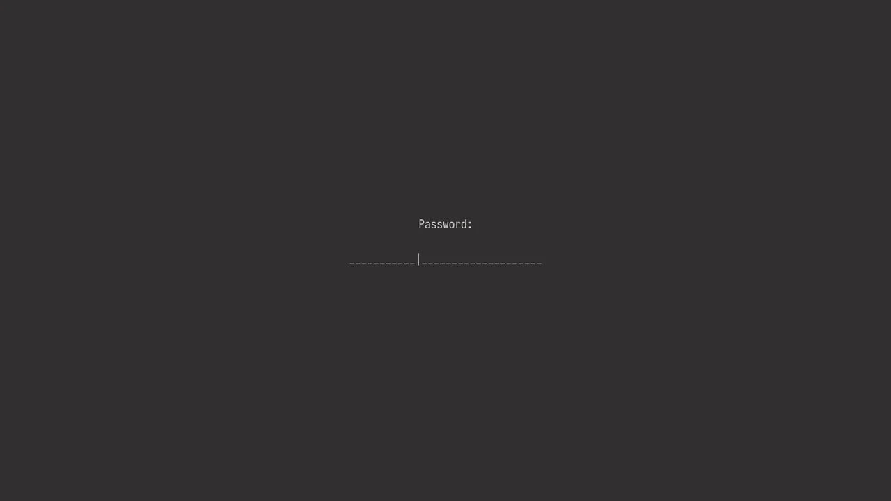<br>**Lock.** xsecurelock, showing neither the account nor the host. |
<!-- END: TOUR -->

## Is This For You

It is worth installing if you run Arch, want a keyboard-driven tiling desktop, and would
rather adopt a coherent one than assemble it. It is worth reading either way — the palette
system and the patchers are the interesting parts, and they are documented on their own.

**What it assumes.** Arch Linux with an X session. A Nerd Font, because the bar draws
private-use glyphs. Optionally an [IPinfo](https://ipinfo.io/) token, without which the
automatic light/dark switch has no sunrise to switch at, and
[yths.backend-service](https://github.com/yths/yths.backend-service), without which the bar
renders but stays empty.

**What it replaces.** Your configuration for every application
[listed below](#what-it-configures). Anything already at one of those paths is renamed to
`*.<timestamp>.bak` first, so nothing is lost, but it stops being what runs.

**How it replaces them.** With symlinks into the clone, not copies. The installed
configuration *is* this repository: editing `~/.config/qtile/config.py` edits the clone, and
deleting the clone takes the desktop with it. That is deliberate — it is what lets a theme
switch rewrite every application at once — but it means the clone is not disposable.

## Install

```bash
git clone https://github.com/yths/yths.dot-files.git
cd yths.dot-files
./bootstrap.sh
```

That is the whole install: packages, the greeter, the services, the configuration, the login
screen. It asks for the sudo password and once whether to collect credentials; then reboot.
`./bootstrap.sh --dry-run` prints what it would do and stops; `--dev` adds the development
packages — ruff, pytest and the test tools — which
[CONTRIBUTING.md](CONTRIBUTING.md#setup) also shows how to add later. NordVPN and Visual
Studio Code are installed by default.

Everything you would change first is in [setup.toml](setup.toml) — the theme, the fallback
font, the package list, which credentials to collect. Edit it before running, and nothing
else needs touching.

One thing stays for later, from the desktop: [the boot splash](configuration/plymouth/README.md)
is installed but only draws once `plymouth` is in the initramfs hooks and `splash` on the
kernel command line — two edits to files that decide whether the machine boots, which the
script will not make for you. [docs/install.md](docs/install.md) has that step and what
else is optional.

Starting from a bare disk instead: [docs/os-build.md](docs/os-build.md).

## Switch Theme

On an installed machine, to apply a bundle from `assets/<bundle>/` everywhere — the running
desktop, the login screen and the boot splash:

```bash
python install.py --migrate --theme <bundle> --system
```

It asks for sudo once, before changing anything; leave out `--system` to switch only the
running desktop, without root. [docs/tips.md](docs/tips.md#switch-the-active-theme) has what
it changes and what it keeps.

## What It Configures

<!-- BEGIN: CONFIGURED -->
*Generated by `helper/gendocs.py` — edits between the markers are overwritten. Change the source it reads from instead.*

What the installer links into place, and where. The screenshots on this page show the `default` theme in `Iosevka NF`, which is what `setup.toml` installs.

| Application | Installed to | For |
|---|---|---|
| bash | `~/.bashrc` | shell |
| dircolors | `~/.dircolors` | `ls` colours |
| xorg | `~/.xinitrc` | session startup and DPI |
| icc | `~/.config/icc` | display colour profiles |
| vim | `~/.vimrc` | editor |
| starship | `~/.config/starship.toml` | shell prompt |
| qtile | `~/.config/qtile` | window manager and bar |
| picom | `~/.config/picom` | compositor |
| tmux | `~/.config/tmux` | terminal multiplexer |
| kitty | `~/.config/kitty` | terminal |
| lock | `~/.config/lock` | screen lock |
| dunst | `~/.config/dunst` | notifications |
| gtk 3 | `~/.config/gtk-3.0` | application toolkit |
| gtk 4 | `~/.config/gtk-4.0` | application toolkit |
| rofi | `~/.config/rofi` | launcher |
| qutebrowser | `~/.config/qutebrowser/config.py` | browser |
| mpv | `~/.config/mpv` | video |
| Visual Studio Code settings | `~/.config/Code/User/settings.json` | editor |
<!-- END: CONFIGURED -->

## Documentation

- [docs/install.md](docs/install.md) — the long form of the above, one step at a time
- [docs/os-build.md](docs/os-build.md) — building the base Arch system from a blank disk
- [docs/architecture.md](docs/architecture.md) — how the pieces fit: bundles, installer, patchers, widgets, backend contract
- [docs/notes.md](docs/notes.md) — the theme system, the widget architecture, the yths.themes contract
- [docs/config-schema.md](docs/config-schema.md) — `~/.config/config.json`, which every component reads
- [docs/palette-semantics.md](docs/palette-semantics.md) — what each palette token means, and the contract a preset must honour
- [docs/palette-reference.md](docs/palette-reference.md) — generated: where each token is used, and which tools still hardcode hex
- [docs/palettes/](docs/palettes/) — what each token looks like, one swatch reference per preset
- [docs/keybindings.md](docs/keybindings.md) — generated: every keyboard binding, grouped by tool
- [docs/dependencies.md](docs/dependencies.md) — generated: every import mapped to the Arch package providing it
- [docs/tips.md](docs/tips.md) — recipes for theme switching, previewing, debugging
- [docs/issues.md](docs/issues.md) — open work
- [docs/style.md](docs/style.md) — how these documents are written

Changing anything here: [CONTRIBUTING.md](CONTRIBUTING.md).

## License

MIT, see [LICENSE.md](LICENSE.md).
